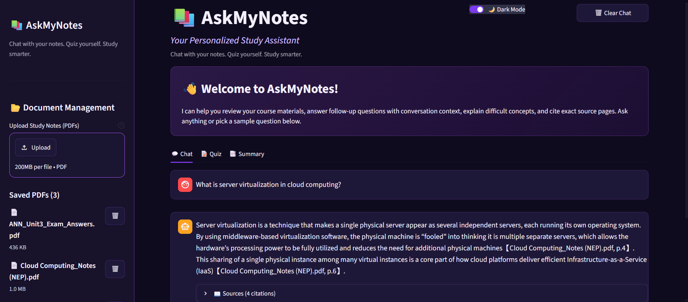
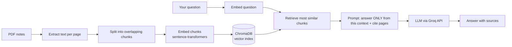

# 📚 AskMyNotes

**A Personalized Study Assistant.** Upload your lecture notes as PDFs, then chat with them, quiz yourself, and generate summaries. Every answer is grounded in your own material and cites the file and page it came from.

🔗 **Live demo:** (https://study-assistant-el2srmqypnv3bub3abiaor.streamlit.app/)



---

## ✨ Features

- **Chat with your notes:** ask questions and get answers based only on your PDFs, with source citations (file name and page) and the matching text snippets.
- **Follow-up questions:** a follow-up like "explain that more simply" is rewritten into a standalone search query using the recent chat history.
- **Quiz mode:** generates 5 multiple-choice questions from a chosen PDF or topic, with instant feedback, explanations and a final score.
- **Summary mode:** structured key points and likely exam topics for any uploaded PDF, downloadable as Markdown.
- **Document management:** upload and delete PDFs from the sidebar, filter searches to specific files, and see index metrics (files, pages, chunks).
- **Polished UI:** light and dark themes, example questions, and clear warnings when the index is missing.

---

## 🧠 How it works

AskMyNotes uses **Retrieval-Augmented Generation (RAG)**. Instead of asking an AI to remember your notes, the app looks up the relevant passages first and hands only those to the AI, like an open-book exam.



**Indexing (once per set of PDFs):** extract text page by page, split it into overlapping chunks, convert each chunk into an embedding, and store it with its file and page number in ChromaDB.

**Answering (every question):** embed the question, retrieve the closest chunks, build a prompt that tells the model to answer only from that context (and to say "I couldn't find this in your notes" otherwise), then show the answer with its sources.

---

## 🛠️ Tech stack

| Area | Tools |
|---|---|
| Language | Python |
| UI | Streamlit (custom CSS, light/dark theme) |
| PDF parsing | pypdf |
| Embeddings | sentence-transformers (`all-MiniLM-L6-v2`) |
| Vector database | ChromaDB (persistent, cosine similarity) |
| LLM | Llama models through the Groq API |
| Config and secrets | python-dotenv locally, Streamlit Secrets when deployed |
| Hosting | Streamlit Community Cloud |

---

## 📁 Project structure

```
├── app.py               # Streamlit interface: chat, quiz, summary, sidebar
├── ingest.py            # Reads PDFs, chunks text, builds the vector index
├── rag.py               # Retrieval, query rewriting, quiz and summary generation, LLM calls
├── test_retrieval.py    # Command-line helper to check what retrieval returns
├── requirements.txt     # Python dependencies
├── .streamlit/          # Theme configuration
└── docs/                # Screenshots
```

---

## 🚀 Run it locally

1. **Clone the repo**
   ```bash
   git clone https://github.com/<your-username>/study-assistant.git
   cd study-assistant
   ```
2. **Create and activate a virtual environment** (Python 3.11 or 3.12 recommended)
   ```bash
   python -m venv venv
   venv\Scripts\activate          # Windows
   source venv/bin/activate       # Mac / Linux
   ```
3. **Install dependencies**
   ```bash
   pip install -r requirements.txt
   ```
4. **Add your API key.** Get a free key from [console.groq.com](https://console.groq.com) and create a file named `.env` in the project folder:
   ```
   GROQ_API_KEY=your-key-here
   ```
5. **Run the app**
   ```bash
   streamlit run app.py
   ```
6. In the sidebar, upload your PDFs and click **Rebuild index**, then start asking questions.

### Deploying on Streamlit Cloud
Add `GROQ_API_KEY = "your-key-here"` under **Settings → Secrets**. Never commit your key to the repository.

---

## 🗺️ Roadmap

- [ ] Evaluation set with hit-rate@k to compare chunk sizes and embedding models
- [ ] Hybrid search (keyword + vector) and re-ranking
- [ ] OCR support for scanned notes
- [ ] Persistent storage so the index survives restarts
- [ ] Flashcards and export of chat history

---

## 💡 Key learnings

1. **RAG is mostly a retrieval problem.** If the right chunk isn't retrieved, no model can answer well. Testing retrieval on its own, before connecting the LLM, made debugging much easier.
2. **Keep components separate.** Retrieval, generation and the UI live in different files. When my first LLM provider became unreliable, I only had to change one function.
3. **Plan for flaky APIs.** I hit `503 model overloaded` errors. Retries with backoff and a fallback model help, but they can't fully fix a provider-side problem, so I switched providers.
4. **Don't hide errors.** A generic "service busy" message covered up the real cause. Surfacing the actual error message made problems fixable in minutes.
5. **Chunking and prompts shape quality.** Chunk size and overlap decide whether an answer survives being split across pieces, and an explicit "answer only from the context, otherwise say you don't know" instruction reduces hallucination.
6. **Secrets stay out of code.** API keys live in `.env` locally and in Streamlit Secrets when deployed, and `.gitignore` keeps private files, notes and the index out of the repository.
7. **Deployment is a different environment.** Cloud hosting has no local `.env`, an ephemeral disk and memory limits, so I had to design for those.
8. **Streamlit reruns the whole script on every interaction.** Using `st.session_state` for chat history, quiz progress and theme was essential, and theming took careful CSS to stay readable in both light and dark mode.
9. **Version control hygiene matters.** I kept test scripts, OS files and secrets out of the repo, and wrote a lean `requirements.txt` instead of a full `pip freeze`.

---

## 👩‍💻 Author

**Sakshi Joshi**, final-year B.Tech student in AI & Data Science

---

*Built as a learning project to understand RAG end to end, from raw PDFs to a deployed app.*
